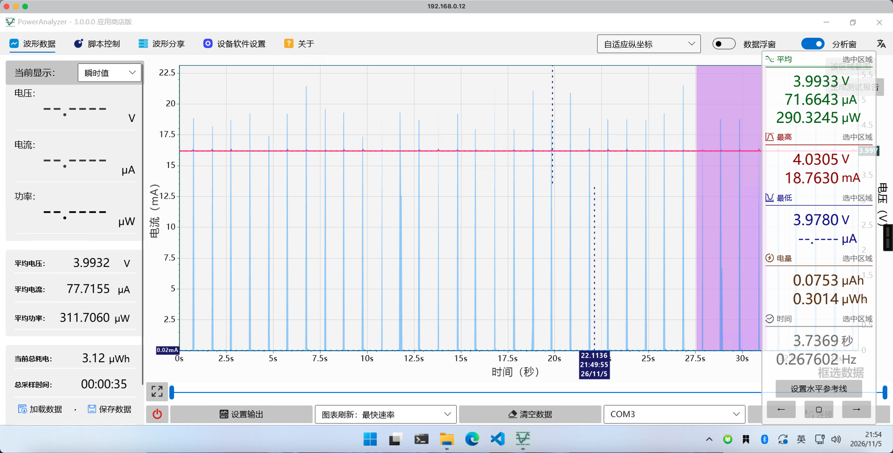

# CH32V208 低功耗

本工程通过 FreeRTOS tickless idle，在 NimBLE 无近期任务时进入 STOP。运行时使用 HSE/PLL，休眠计时使用 HSE 参考测频的 LSI/2。所有低功耗镜像在每次复位后都先等待 **10 秒**，之后才允许 STOP 和关闭 SWJ，便于恢复烧录。

## 构建与使用

复现当前已测的 1 秒广播配置：

```sh
GPIO_ANALOG=ON scripts/power-profile.sh 1000 --flash
```

该命令生成 `build-power-1000-analog/ch32v208_nimble.{elf,hex,bin}`，使用 96 MHz、LSI/2、3 ms 提前唤醒、未用 GPIO 模拟输入，关闭 app 周期日志。支持的广播间隔为 100、500、1000、2000、5000 ms。测量档使用独立静态随机测试地址，避免与其他 GATT 配置的客户端缓存混淆。

常规开发构建：

```sh
scripts/build.sh
# 关闭 tickless STOP：
LOW_POWER=OFF scripts/build.sh
# 可选 LSE；当前板上尚未验证起振：
POWER_LSE=ON scripts/build.sh
```

配置集中在 `cmake/project-options.cmake`：

| CMake 选项 | 默认值 | 用途 |
|---|---|---|
| `CH32_LOW_POWER` | ON | FreeRTOS tickless STOP |
| `CH32_POWER_LSE` | OFF | 改用 LSE/2；默认使用 HSE 参考测频的 LSI/2 |
| `CH32_POWER_WAKE_GUARD_US` | 3000 | 提前唤醒余量，单位 µs |
| `CH32_POWER_GPIO_ANALOG` | OFF | 未用 GPIO 设为模拟输入；OFF 为下拉输入 |
| `CH32_POWER_RF_GATE` | ON | PHY 空闲期间关断 RF 模拟使能 |
| `CH32_POWER_DIAGNOSTICS` | ON | 每秒输出运行统计；功耗测量档关闭 |
| `CH32_ADV_INTERVAL_MS` | 100 | 广播间隔，单位 ms，范围 20～10240 |

复现已测功耗需要明确指定 `GPIO_ANALOG=ON`，常规构建的默认 GPIO 配置仍为下拉输入。`scripts/power-profile.sh` 还可通过 `SYSCLK_MHZ`、`POWER_GUARD_US` 和 `RF_GATE` 覆盖相应参数。

## GPIO 配置与项目迁移

**当前测量镜像将未用 GPIO 统一设为模拟输入。实际项目中使用中的 GPIO 可能不应设为模拟输入，必须按板级连接逐脚配置。**

`port/wch_power.c::park_unused_io()` 当前保留 PA9 UART TX、PC14/PC15 晶体引脚和 PD0/PD1 HSE 引脚，其余 GPIOA/B/C/D 引脚按选项设为模拟输入或下拉输入。无 BLE 的 `boot.elf` 还保留 SWJ/PA13/PA14，便于调试。

| 引脚用途 | 休眠配置原则 |
|---|---|
| 完全未使用 | 可设模拟输入，关闭数字输入缓冲器和内部上下拉 |
| 按键、数字输入、EXTI 唤醒 | 保留数字输入，按外部电平选择上拉、下拉或外部偏置 |
| UART、SPI、I²C、片选及其他控制脚 | 保留所需功能，并核对外围器件休眠电平 |
| 晶振引脚 | 保留时钟功能 |

WCH 应用手册 §10.2.9 说明，模拟输入会断开输出缓冲器、禁用数字施密特输入和上下拉。内部下拉若遇到外部高电平会产生额外电流，因此统一下拉并不适用于所有板子。当前引脚模式用于本验证板测量；间歇高电流平台的最新判断见下方测量注意。

本实现独占 RTC/备份域，初始化会重置备份域，不保留墙上时钟和备份寄存器。产品接入已有 RTC 或外设时，需调整资源与引脚配置。

## 实测功耗

用户提供的功耗仪截图对应上述 **1 秒广播、96 MHz、LSI/2、3 ms 余量、模拟输入 GPIO** 测量档。测量点为 ME6230 稳压器上游，约 4 V。

| 统计范围 | 平均电压 | 平均电流 | 时长 |
|---|---|---|---|
| 完整记录（截图左侧） | 3.9932 V | **77.7155 µA** | 约 35 s |
| 选中区间（截图右侧） | 3.9933 V | **71.6643 µA** | 3.7369 s |



以上数值读取自截图，两种统计窗口应分别引用。其他广播间隔尚无当前 GPIO 配置下的功耗实测。独立裸机 STOP 的约 **22 µA** 是 3.3 V MCU 支路休眠平台，不是完整 BLE 的平均电流。

**测量功耗时拔掉 WCH-Link，让目标由功耗仪独立供电，再复位并等待十秒启动窗口结束。** 停止 BLE 主动扫描和客户端连接，关闭周期诊断日志；记录供电点及是否包含稳压器等负载。UART 线也可能影响电流，需保持对照条件一致。不要在运行测量中附加 RTT/GDB 或读 RAM，本板的调试访问会暂停 CPU，干扰 BLE 时序。

用户反馈拔掉 WCH-Link 后，广播峰之间约 **350 µA** 的间歇平台消失。可能是唤醒时调试器重新连接，影响了部分模块的低功耗状态；具体重连行为和受影响模块尚未验证。此现象暂按调试器连接带来的测量影响处理，以拔掉 WCH-Link 后的结果为准，不再继续追查，也不再将它作为 GPIO 模式或未进入 STOP 的已确认问题。

## 原厂 BLE_UART 示例参考数据

[《CH32V208蓝牙从机sleep模式下功耗测试》](https://www.cnblogs.com/frontier/p/17732900.html)使用原厂 BLE_UART 示例、CH32V208W 开发板及 `HAL_SLEEP=TRUE`；去除额外负载，连接 VDD/VIO 后直接给 VDD 供电。文章汇总表如下：

| 广播间隔 | 参考平均电流 |
|---|---|
| 500 ms | 120.02 µA |
| 1 s | 72.62 µA |
| 2 s | 48.09 µA |
| 5 s | 33.05 µA |
| 关闭广播 | 23.45 µA |

这是外部文章对原厂示例的测试结果，非数据手册保证值。本工程的供电点和统计窗口不同，广播载荷、扫描响应等条件也需统一后才能严格比较。该文文字建议按外部电平选择上下拉，而代码使用 `GPIO_Mode_AIN`，实际项目应结合引脚用途选择。

## 休眠与唤醒实现

核心实现位于 `port/wch_power.c`，时间换算位于 `port/wch_power_math.h`，TIM3 补偿接口位于 `port/hal_timer_wch.c`。

1. FreeRTOS 暂停调度器后调用 tickless hook。移植层保存并屏蔽全局 MIE/MPIE 响应，检查内核状态、pending IRQ、UART DMA/TC 和 PHY 空闲状态。
2. 在内核超时和 NimBLE 定时器截止时间中取较早者，扣除 SysTick 当前 tick 相位；最长预算为 10 秒。短窗口使用保持 HSE/PLL、TIM3 和 SysTick 的普通 WFE。
3. 有至少 10 ms 实际 STOP 窗口时，提前 3 ms 设置 RTC 闹钟。RTC 二分频，EXTI17 保持 event 使能，RTCAlarm PFIC IRQ 禁用；停止 TIM3 和 SysTick，关断 RF 模拟使能后进入 RAM 低压保持 STOP/WFE。
4. 事件唤醒返回原程序流，先 `SystemInit()` 恢复 HSE/PLL，再按 RTC 经过时间补偿 TIM3 和 FreeRTOS tick。RTC 转换的小数余量及不足一个 tick 的相位跨休眠保留，同步和恢复开销也计入时间。
5. 重设定时器截止点、恢复 RF 使能，最后恢复全局中断响应。唤醒 ISR 和任务调度因此在系统时钟及时间基准恢复后执行。

此顺序针对[唤醒 ISR 先于时钟恢复触发调度的问题](https://club.rt-thread.org/ask/question/86753b2846f086a8.html)。屏蔽全局响应时仍保留 RTC 事件源，不能直接关闭 EXTI 唤醒源。普通睡眠使用 SEVONPEND，先消费旧事件、检查 pending，再执行一次 WFE，避免检查与睡眠之间丢事件。外部提前唤醒尚未完成实机验证，产品加入其他唤醒源时需单独适配。

LSI 测频参考 WCH `RTC.c::Calibration_LSI`：以 HCLK 统计 128 个 CK32K 周期，丢弃首轮捕获，按 14 位计数器溢出步长重建频率。启动及每 10 秒异步测量，采样期间保留 HSE；超时 50 ms 则关闭后续 STOP，不修改 LSI trim。NimBLE 的低功耗 SCA 预算暂设 500 ppm，尚未作仪器级精度或全温验证。

RF 模拟关断参考 WCH `tmos_proces_idle` 对 `RFEND[0x08]` 四个使能位的处理：常规 shutdown 留下 RX ADC 使能，空闲休眠额外关断，并在恢复中断前恢复原值；不改变校准、DMA 和射频事件时序。

## 验证范围

- 模拟输入测量档：1M→2M 切换，两档各 16 字节写入回读通过，0 失败。
- 相同 STOP 时序的 1 秒广播下拉输入档：1M/2M 各 60 秒，合计 263 轮回读通过；不计作模拟输入档的长测。
- 休眠路径：120 秒短测完成 121 次 STOP，全部在时钟恢复前读到 HSI；未发现 RF/HSE/PWR 配置异常。
- 时间换算测试覆盖 72/96/144 MHz、非整数 LSI 频率、十万次分段累计、当前 tick 相位及 RTC/cputime 回卷。

尚需长期组合时基精度、低功耗下 Coded PHY、外部提前唤醒和温变验证。当前接入 FreeRTOS，未实现 RT-Thread PM 移植。源码整理后已通过构建和主机测试，并重新烧录、确认 1 秒广播启动；尚未重做整理后镜像的 BLE 长测。上述功耗截图保留为整理前同参数镜像的测量记录。

主机时间换算测试：

```sh
cc -std=c11 -Wall -Wextra -Werror -Iport tests/power_math.c -o /tmp/ch32-power-math
/tmp/ch32-power-math
```

WCH-LinkE 在 STOP 中通常无法重新连接；NRST 与 `--connect-under-reset` 未能稳定恢复时，可用 BOOT＋RESET 进入可烧录状态。启动应用前恢复正常 BOOT 电平，每次正常复位仍有十秒窗口。独立芯片唤醒实验见 [低功耗 demo](low-power-demo.md)。
